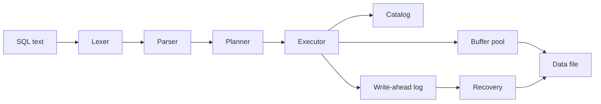

# Keel

Keel is a relational database engine written in C++20. Pages live on disk, a buffer pool decides which of them stay in memory, and SQL is compiled into a tree of iterators. A write-ahead log makes a committed transaction survive a crash even when the data file was never flushed.



## Build and test

The default `c++` on some machines is Clang without libstdc++. Configure with g++.

```sh
cmake -S . -B build -DCMAKE_BUILD_TYPE=Debug -DCMAKE_CXX_COMPILER=g++ -DKEEL_ASAN=ON
cmake --build build -j
ctest --test-dir build --output-on-failure
```

The `keel` binary opens a database and a prompt. Statements end at a semicolon.

```sh
cmake --build build --target keel_cli
./build/keel_cli /tmp/play.db
./build/keel_cli /tmp/play.db -c "CREATE TABLE t (id INT PRIMARY KEY); INSERT INTO t VALUES (1);"
```

Release build, used for the numbers below:

```sh
cmake -S . -B build-release -DCMAKE_BUILD_TYPE=Release -DCMAKE_CXX_COMPILER=g++ -DKEEL_ASAN=OFF
cmake --build build-release --target keel_bench
./build-release/keel_bench
```

`keel_bench` needs SQLite development headers (`libsqlite3-dev`). It rewrites `bench/results.json` and checks that Keel and SQLite return the same rows before it records a time.

## SQL

Supported statements:

- `CREATE TABLE` with `INT`, `DOUBLE`, `BOOL`, and `VARCHAR(n)` / `TEXT`, plus `PRIMARY KEY` and `NOT NULL`
- `CREATE [UNIQUE] INDEX name ON table (columns)`
- `INSERT`, `UPDATE`, `DELETE`
- `SELECT` with `WHERE`, `JOIN` / `INNER JOIN` / `CROSS JOIN`, `GROUP BY`, aggregates (`COUNT`, `SUM`, `AVG`, `MIN`, `MAX`), `ORDER BY`, and `LIMIT`
- `BEGIN`, `COMMIT`, `ROLLBACK`
- `EXPLAIN` and `EXPLAIN ANALYZE`

Predicates include comparisons, `AND` / `OR` / `NOT`, `IS NULL`, and `+ - * /`. One transaction is open at a time. A statement that fails aborts that transaction.

## Benchmark

Measured on a Release build (`g++ -O3`, sanitizers off) against SQLite 3.45.1. Keel ran with `sync` on, a 256-page clock pool, and one fsync at commit. SQLite used `journal_mode=WAL` and `synchronous=FULL`. The scale is 400 customers, 2,000 orders, and 5,000 line items. Each query time is the median of 5 runs after one warmup. The buffer pool was cold at process start; the operating-system cache was warm. The harness rejects a timing if the two engines disagree on the rows.

| Workload | Keel | SQLite 3.45.1 |
| --- | ---: | ---: |
| Bulk load | 754.465 ms | 8.51577 ms |
| `COUNT` / `SUM` over lineitem | 1.11126 ms | 0.253215 ms |
| 200 primary-key lookups | 16.5534 ms | 0.60799 ms |
| Secondary index lookup (5 rows) | 0.07617 ms | 0.005337 ms |
| Hash join + `GROUP BY` (25 groups) | 0.96894 ms | 0.786011 ms |

The primary-key lookup plan is an `IndexScan` on `customer_pk`. `SELECT COUNT(*) FROM lineitem WHERE l_orderkey >= 0` is a `SeqScan` and missed 46 buffer-pool pages on a cold pool. Crash recovery of 500 committed rows, repeated 5 times by discarding dirty pages after commit, lost 0 commits. Mean time to reopen and read the rows back was 68.0475 ms.

Keel is slower to load because every page update stores a full before-image and after-image. That choice is explained in [docs/WALKTHROUGH.md](docs/WALKTHROUGH.md).

## Browser

`web/` is a Next.js app that runs the engine compiled to WebAssembly. The module checked in under `web/public/keel/` is what `npm run build` serves, so a deploy does not need Emscripten.

```sh
cd web
npm ci
npm run dev
```

The dev server listens on port 43123. `npm run build` produces the production bundle.

Rebuild the module when the engine changes:

```sh
./scripts/build_wasm.sh
```

The script expects the Emscripten SDK at `/tmp/emsdk`. It writes `web/public/keel/keel.js` and `keel.wasm`.

## Layout

| Path | What it is |
| --- | --- |
| `include/keel`, `src` | Storage, indexes, log, parser, planner, executor |
| `tests` | GoogleTest and SQL logic scripts |
| `bench` | SQLite comparison |
| `web` | SQL playground |
| `docs/WALKTHROUGH.md` | Design notes |
| `docs/RESUME.md` | Three resume lines taken from the measurements above |
